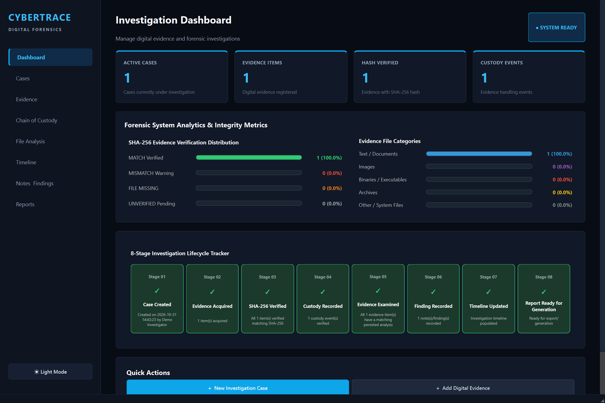

# CyberTrace

CyberTrace is a local desktop application for organizing digital-forensics investigations and reviewing collected evidence. It is built with Python, PySide6, and SQLite.

## Preview

The dashboard below is a screenshot of the running application populated with synthetic demonstration data.

<p align="center">
  
</p>

## Features

- Create and manage investigation cases, with case health and lifecycle tracking.
- Acquire and register evidence, calculate SHA-256 hashes, and check preserved-copy integrity.
- Record chain-of-custody events and verify custody chains.
- Examine file metadata and save analysis results, notes, and findings.
- Review investigation timelines, replay events, and explore cross-evidence relationships.
- Generate HTML forensic reports and executive summaries.
- Switch between dark and light themes.

## Requirements

- Python 3.10 or later
- PySide6

## Run from source

From the repository root, create a virtual environment and install the GUI dependency:

```powershell
py -m venv .venv
.venv\Scripts\Activate.ps1
python -m pip install --upgrade pip
python -m pip install PySide6
```

Start the application:

```powershell
python main.py
```

## Run tests

```powershell
python -m unittest discover -s tests -v
```

## Windows packaging

The repository includes a PyInstaller spec and an Inno Setup installer script. To build the application directory:

```powershell
python -m pip install PyInstaller
pyinstaller --noconfirm CyberTrace.spec
```

The current packaging files contain absolute `D:\CyberTrace` paths. If your checkout is in a different location, update the paths in `CyberTrace.spec` and `installer/CyberTrace.iss` before building. The installer script also requires Inno Setup 6.

## Local data

CyberTrace stores its case database, preserved evidence, and generated reports locally. When run from source, these are stored under the repository root in `data`, `evidence`, and `reports`. A packaged Windows build stores them under `%LOCALAPPDATA%\CyberTrace`. Back up this data alongside any other case materials you need to retain.
